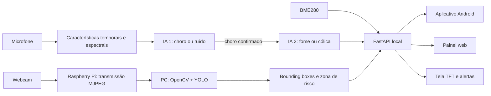

# CrySense AI

> Protótipo de IA e IoT para monitoramento infantil: análise de áudio, sensores ambientais, vídeo e aplicativo Android.

**Estado:** protótipo experimental, dependente do hardware e da configuração descritos na documentação. As classificações de áudio não são diagnósticos nem prova clínica de fome ou cólica.

**Stack:** Python · FastAPI · scikit-learn · OpenCV/YOLO · Kotlin/Jetpack Compose · Raspberry Pi

## Sobre o projeto

O **CrySense AI** foi criado para oferecer mais tranquilidade e segurança aos cuidadores, especialmente a pais de primeira viagem. Em vez de apenas transmitir áudio e vídeo, o sistema utiliza inteligência artificial para identificar o choro do bebê e classificar seu padrão como mais associado à **fome** ou à **cólica**.

Conforme a implementação documentada em `raspberry/README.md`, o áudio é padronizado em 16 kHz e convertido em descritores temporais e espectrais, como energia, cruzamento por zero, centroide, largura de banda e fluxo espectral. Os modelos comparam essas características com os exemplos utilizados no treinamento. O processamento acontece em duas etapas: a primeira IA diferencia `choro` de `ruído`; a segunda é executada somente após a confirmação do choro e o classifica como `fome` ou `cólica`.

O sistema também reúne vídeo ao vivo, dados ambientais e visão computacional. O Raspberry Pi transmite as imagens pela rede local, enquanto um computador pode executar **OpenCV + YOLO** para localizar pessoas com *bounding boxes* e verificar a entrada em uma zona de risco desenhada pelo próprio usuário sobre o berço. Alertas, medições e ocorrências ficam disponíveis no aplicativo Android, no painel web e na tela TFT.

Quando um padrão associado à cólica é identificado, o protótipo pode acionar uma intervenção sonora configurável, como ruído branco ou rosa. O histórico local permite acompanhar a recorrência das ocorrências e oferece informações de apoio aos cuidadores.

> O CrySense AI não realiza diagnóstico médico, não substitui avaliação profissional e não dispensa a supervisão de um responsável.

## Problema que busca solucionar

O choro é um dos principais meios de comunicação do bebê, mas sua interpretação pode gerar dúvida e ansiedade. O CrySense AI busca reduzir essa incerteza reunindo análise do choro, monitoramento visual, condições ambientais, alertas de risco e histórico de eventos em uma solução local, responsiva e centrada na privacidade.

## Como funciona



O Raspberry Pi permanece responsável pela captura de áudio, sensores, interface local e transmissão do vídeo. A visão computacional é executada no computador para preservar o desempenho do Raspberry Pi 3B.

## Funcionalidades

- Monitoramento contínuo do áudio e do ambiente.
- Detecção de `choro` × `ruído`.
- Classificação do choro como `fome` × `cólica`.
- Extração de características temporais e espectrais do áudio.
- Análise de arquivos WAV para demonstrações em ambientes barulhentos.
- Vídeo ao vivo no painel web e no aplicativo Android.
- Detecção de pessoas com YOLO e exibição de *bounding boxes*.
- Zona visual de risco desenhada pelo usuário sobre o vídeo.
- Alertas locais no aplicativo, painel web e tela TFT.
- Monitoramento de temperatura, umidade e pressão atmosférica.
- Histórico de ocorrências armazenado localmente.
- Intervenção sonora configurável em eventos associados à cólica.
- Rede Wi-Fi de emergência para demonstrações e feiras.

## Tecnologias

| Área | Tecnologias |
|---|---|
| Computação embarcada | Raspberry Pi 3B e Raspberry Pi OS Lite |
| Backend | Python, FastAPI, API REST e SQLite |
| Aprendizado de máquina | scikit-learn, Random Forest, NumPy e Joblib |
| Processamento de áudio | Descritores temporais e espectrais |
| Visão computacional | OpenCV e Ultralytics YOLO |
| Aplicativo móvel | Kotlin e Jetpack Compose |
| Comunicação | Wi-Fi local, HTTP e vídeo MJPEG |
| Hardware | BME280, INMP441, MAX98357A, webcam USB e TFT ST7735 |

## Metodologia

- **Pipeline em duas etapas:** a classificação do tipo só ocorre após a confirmação do choro.
- **Confirmação temporal:** limiares de confiança e múltiplas janelas consecutivas reduzem ativações isoladas.
- **Arquitetura local-first:** áudio, vídeo, eventos e dados sensíveis permanecem sob controle da rede local.
- **Processamento distribuído:** o Raspberry mantém as funções embarcadas e o computador executa o YOLO.
- **Zona configurável:** a área de risco é marcada pelo cuidador conforme a posição real da câmera e do berço.

## Objetivo

O projeto visa apoiar decisões rápidas, reduzir a ansiedade dos cuidadores e aumentar a percepção de segurança durante a rotina do bebê, sem substituir o cuidado humano.

## Estrutura do repositório

```text
CrySense/
├── android/      # Aplicativo Android em Kotlin e Jetpack Compose
└── raspberry/    # Backend Python, modelos, datasets, testes e implantação
```

O diretório [`raspberry`](raspberry/) contém o servidor local completo, os serviços de hardware, o servidor de visão para o computador, os modelos treinados e os datasets utilizados no projeto. O diretório [`android`](android/) contém o projeto importável no Android Studio.

## Execução e instalação

As instruções de preparação do Raspberry Pi, treinamento, testes, instalação como serviço, API, servidor YOLO e uso do painel estão em [`raspberry/README.md`](raspberry/README.md).

Para o aplicativo, siga [`android/README.md`](android/README.md). O painel principal se comunica diretamente com o Raspberry Pi e pode ser compilado sem Firebase. A integração legada é ativada somente se o desenvolvedor fornecer seu próprio `android/app/google-services.json`, que não é publicado.

## Dados e privacidade

O processamento principal foi projetado para ocorrer localmente. Credenciais, bancos de eventos, registros de execução, ambientes virtuais e artefatos de compilação não fazem parte do repositório. Antes de usar o sistema com dados reais, revise permissões de rede, retenção de eventos e consentimento para captação de áudio e vídeo.

## Escopo e avaliação

Este repositório apresenta uma implementação baseada em Raspberry Pi e aplicativo Android. A implementação baseada em ESP32 está em [CrySenseAI](https://github.com/VantuilPJr/CrySenseAI); os dois projetos têm hardware e instruções próprios.

As descrições de classificação indicam o objetivo e o comportamento do protótipo, sem afirmar precisão clínica, certificação ou desempenho generalizável. O modelo depende da qualidade dos dados, das condições de captação e da validação no ambiente de uso. Consulte a documentação do Raspberry para conhecer treinamento, execução e testes disponíveis.

## English summary

CrySense is an experimental baby-monitoring prototype combining a two-stage audio classifier, environmental sensors, local video, an Android app and optional computer-vision processing on a separate computer. It uses Python/FastAPI, scikit-learn, Kotlin and Raspberry Pi. Its cry labels are experimental classifications, not medical diagnoses or clinically validated determinations. Setup and test instructions are maintained in the Raspberry and Android documentation.
